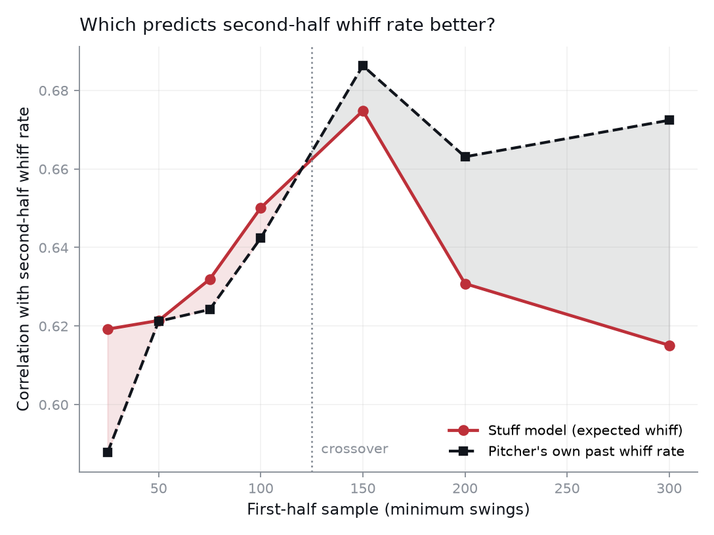
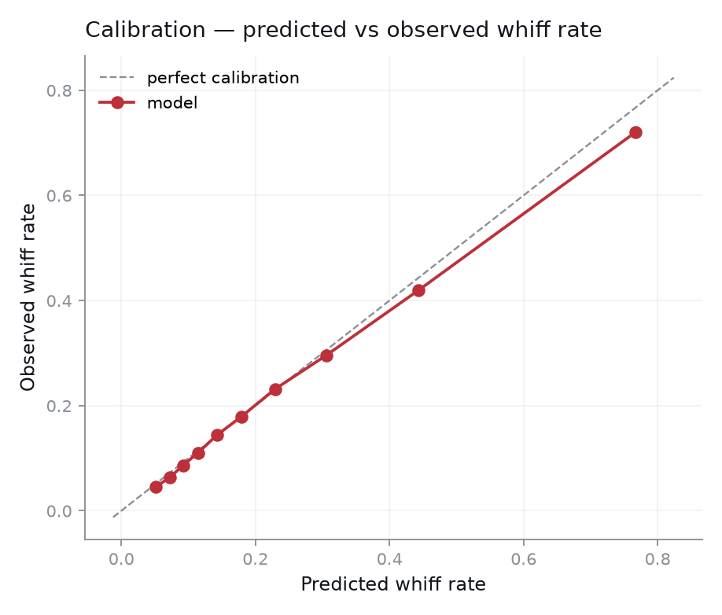

# pitchquality — an expected-whiff model for pitch evaluation

[](https://github.com/jakeyoung1/pitchquality/actions/workflows/ci.yml)

Estimates the probability that a swing misses, from the physical properties of
the pitch. Trained on 2025 Statcast, evaluated on a **held-out 2026 season** the
model never saw.

The point is not the AUC. The point is separating **stuff** — what a pitcher
does to the ball, which travels with him — from **results**, which are
contaminated by the hitters he faced, where he located, and luck.

```bash
python -m venv .venv && .venv/bin/pip install -e ".[dev]"
.venv/bin/python scripts_fetch.py      # download + cache Statcast (~2 min)
.venv/bin/python -m pitchquality.cli   # fit, evaluate, write reports/
.venv/bin/python -m pytest tests -q    # 94 tests
```

## Data

| Season | Pitches | Swings | Whiff rate | Role |
|---|---|---|---|---|
| 2025 | 711,897 | 335,769 | .2316 | train |
| 2026 (through Aug 19) | 562,799 | 264,629 | .2296 | held-out test |

Whiff is conditioned on a swing. Modeling `P(whiff | pitch)` would confound
pitch quality with plate discipline — a pitch nobody offers at scores well for
entirely the wrong reason.

## Held-out performance (train 2025 → test 2026)

| Model | AUC | Log loss | Brier |
|---|---|---|---|
| Baseline (pitch-type mean whiff rate) | .6133 | .5233 | .17158 |
| **Stuff** (release characteristics only) | **.7674** | .4465 | .14187 |
| Full (stuff + location + count) | .7875 | .4303 | .13598 |

## The result that mattered

The first version of the stuff model scored **.652 AUC** and *lost* the
predictive-validity test — a pitcher's own past whiff rate forecast his future
whiff rate better than the model did. That is the correct reason to reject a
model, so the question became what it could not see.

The answer was **approach angle**. Statcast publishes trajectory as
position/velocity/acceleration at y = 50 ft; the angle the hitter actually sees
has to be integrated forward to the plate. A flat vertical approach angle at the
top of the zone misses bats that the same velocity and spin would not miss on a
steeper plane, and VAA is not recoverable from velocity and movement alone.

Adding VAA and HAA moved the stuff model from **.652 → .767 AUC**.

## Does the grade actually predict anything?

Splitting 2026 at its median date and forecasting second-half whiff rate
(330 pitchers, ≥100 swings per half):

| Predictor | r | R² |
|---|---|---|
| First-half **expected** whiff (model) | .6443 | .4151 |
| First-half **actual** whiff (outcome) | .6369 | .4056 |
| **50/50 blend of the two** | **.6827** | **.4661** |

The honest reading: the model beats raw outcomes, but *narrowly*. The defensible
claim is not that stuff replaces results — it is that stuff carries information
results do not, which is why the blend beats either alone.

### Where the model earns its keep

Sweeping the first-half sample threshold, with the second-half target held fixed
at ≥150 swings so only the predictor's sample varies:

| Min swings (H1) | n | r model | r outcome | model advantage |
|---|---|---|---|---|
| 25 | 335 | .6192 | .5878 | **+.0314** |
| 50 | 324 | .6214 | .6212 | +.0002 |
| 75 | 319 | .6319 | .6242 | +.0076 |
| 100 | 302 | .6501 | .6424 | +.0077 |
| 150 | 268 | .6748 | .6863 | −.0115 |
| 200 | 211 | .6308 | .6631 | −.0323 |
| 300 | 133 | .6151 | .6724 | **−.0573** |

Whiff rate stabilizes quickly, so with 300 swings in hand a pitcher's own
results win and the model should not be used in preference to them.



The model's
advantage is concentrated exactly where scouting decisions are hardest: a
prospect with 25 swings of data, a reliever just called up, a deadline target
three weeks into a new pitch.

## Face validity

Top of the 2026 Stuff+ leaderboard: Mason Miller, Josh Hader, Andrés Muñoz,
Ryan Helsley, Brendon Little, Jeremiah Estrada, Fernando Cruz, Jeff Hoffman,
Blake Snell, Jacob Misiorowski. A stuff model that did *not* surface these arms
would be broken regardless of its AUC.

`whiff_over_expected` — actual minus expected — is the residual worth reading.
Pitchers persistently above it are getting misses their raw stuff does not
explain, which points at deception, sequencing, or a release the model has not
captured.

## Known limitations

- **Overconfident at the top.** Calibration is tight through the eighth decile,
  then drifts: the top decile predicts .767 and observes .720. High-stuff pitches
  are graded slightly too generously.

  

- **Compressed at the velocity extremes.** The model under-predicts whiffs above
  99 mph and over-predicts below 90 — regularization pulling toward the mean.
- **Whiff is not run prevention.** A swing-and-miss model says nothing about
  contact quality. A complete pitch-quality metric needs an expected-damage
  component alongside this one.
- **No hitter adjustment.** Facing a lineup that chases is not distinguished
  from beating a disciplined one.
- **Single-season training.** No multi-year stability testing, and no accounting
  for within-season Statcast calibration drift.
- **Grades are descriptive of a window**, not projections. There is no aging
  curve and no regression to a population prior.

## Live dashboard

**Live URL:** not deployed yet. The deploy config is ready, but the Render
service has to be created from Jake's Render account: New, Blueprint, pick this
repo and branch, keep the free plan. The URL goes on this line once it exists.

| Page | What it shows |
|---|---|
| `/` | 2026 leaderboard: search, sort, minimum-sample filter |
| `/pitchers/{id}` | One pitcher's season line, rank, and pitch-type split |
| `/model` | Model card: held-out AUCs, validity tests, figures, limitations |
| `/api/leaderboard`, `/api/pitchers/{id}`, `/api/model-card`, `/api/health` | The same data as JSON. Interactive docs at `/docs` |

The 2026 season is over, so the site shows a finished season. It does not score
live games.

### Architecture

```
reports/*.csv, *.png          data/pitchquality.db (SQLite)
  model card numbers            pitches, leaderboard, meta
  and figures                           |
        \                               |  opened read-only
         +------> src/pitchquality/web (FastAPI + Jinja) ------> Render free tier
```

- **Storage.** `data/pitchquality.db` holds three tables: `pitches` (one row per
  scored pitch), `leaderboard` (one row per pitcher and season), and `meta`
  (key/value: `model_version`, `last_fetch_date`, `train_auc`, `test_auc`). The
  service reads those columns by name and never writes.
- **Service.** `src/pitchquality/web` is a FastAPI app with server-rendered
  pages and a few lines of JavaScript. It imports none of the modeling
  code, so the deploy installs `requirements-web.txt` (FastAPI, Uvicorn, Jinja)
  and skips pandas and scikit-learn.
- **Model card.** The AUCs, validity tables, and figures come straight from the
  files in `reports/`.
- **Deploy.** `render.yaml` defines one free web service. Render builds on every
  push to the deployed branch. The free tier sleeps when idle, so the first
  request after a quiet spell is slow.

Run it locally:

```bash
.venv/bin/pip install -e ".[dev,web]"
.venv/bin/python -m pitchquality.web.seed        # build data/pitchquality.db from reports/
.venv/bin/uvicorn pitchquality.web.app:app --reload
```

### What the database holds today

The data pipeline that backfills the rest of 2026 and writes pitch-level rows
has not landed yet. Until it does, `python -m pitchquality.web.seed` builds the
database from the reports already committed here: the 554 pitcher grades in
`reports/pitcher_stuff_grades.csv` and the held-out AUCs in
`reports/model_performance.csv`. That covers 2026 through Aug 19. The `pitches`
table is created empty and `train_auc` is left blank, because the repo holds no
pitch-level data and no recorded training AUC. Nothing is filled in by hand.

### How the daily refresh works

The refresh is the pipeline's job, and it is designed around one constraint:
Render's free tier has no persistent disk, so the database has to arrive with
the deploy.

1. A scheduled GitHub Actions job fetches any new Statcast pitches, scores them
   with the saved model, and rewrites `data/pitchquality.db`.
2. The job commits the database. Render sees the push and redeploys.
3. The build runs `python -m pitchquality.web.seed --if-missing`. With a
   committed database present, that step does nothing and the service serves
   the pipeline's file. With none, it falls back to the seed described above.

In the offseason step 1 finds no new pitches and the job changes nothing. Steps
1 and 2 ship with the pipeline. Step 3 and the service are in this repo now.

## Layout

```
src/pitchquality/
  features.py   targets, handedness mirroring, approach angles, FB differentials
  model.py      three models, held-out evaluation, calibration table
  grades.py     Stuff+ index, predictive validity, sample-size sweep, blending
  plots.py      calibration, velocity curve, movement maps, scatter
  cli.py        end-to-end pipeline
  web/          live API and dashboard (FastAPI, reads data/pitchquality.db)
tests/          94 tests
reports/        CSVs + figures written by the pipeline
render.yaml     Render free-tier deploy for the dashboard
```
